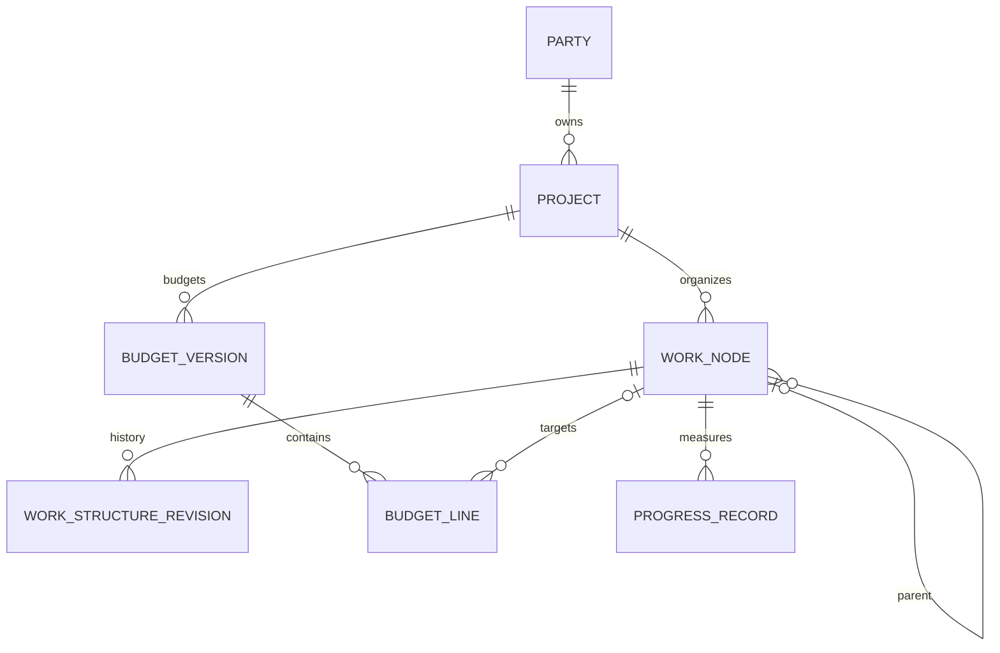
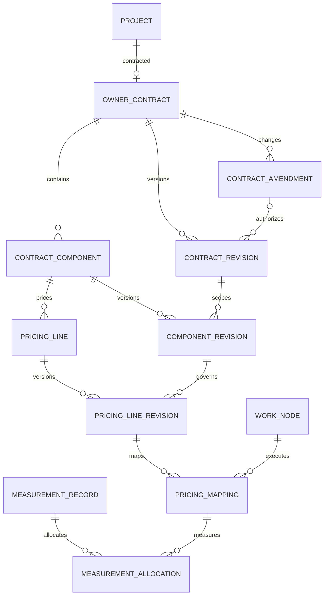
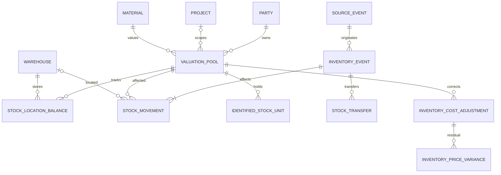
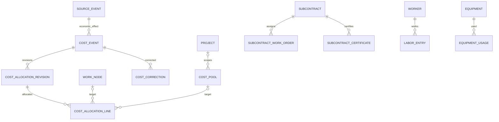
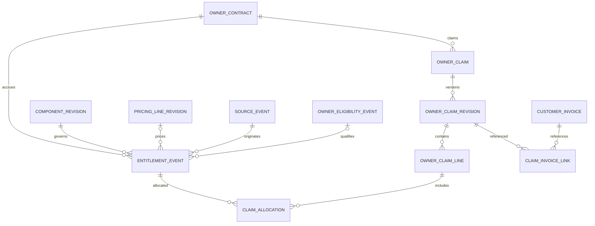
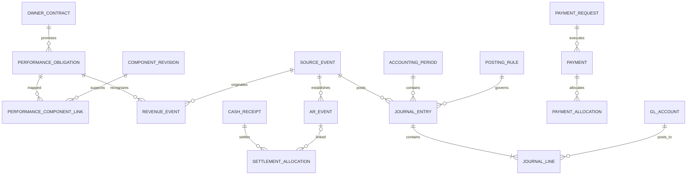
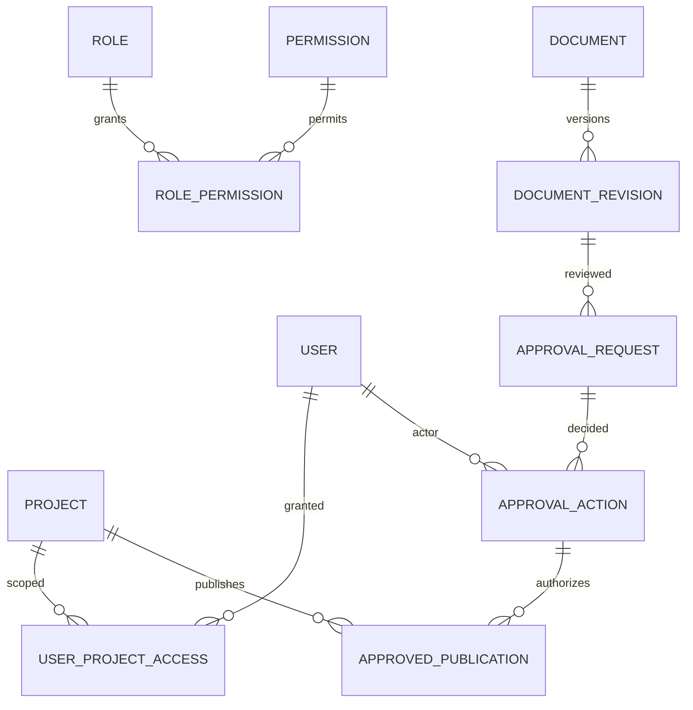

# Data Model & Logical Schema — ERP شركة النهضة للبناء والتشييد

- الملف: `data_model_schema.md`؛ الإصدار: 1.6؛ الدفعة الثالثة؛ 2026-11-22.
- الحالة: [PROPOSED] — تجميع النموذج المنطقي v0.3 ومراجعة اتساقه. اعتماد قواعد الأعمال لا يعني اعتماد كل اسم أو حقل أو آلية تنفيذ في هذه الوثيقة.
- المصدر: نصوص Data Model & ERD v0.1–0.3 وData Integrity & Transaction Rules v0.1 وCTR-D02–05 وDM-D01–05 في المحادثة؛ سياق SRS/INV/DEC/ACC/BPM السابق؛ الملفات الأربعة المتاحة محلياً من الدفعتين الأولى والثانية. SRS v0.1 الأصلي الكامل [MISSING FROM CONTEXT]. لا ادعاء بتغطية التصميم لجميع المتطلبات الفردية.
- الاعتماديات: `project_state.md` v1.6؛ `domain_glossary.md` v1.6 (الأسماء والدلالات)؛ `decisions_ledger.md` v1.6 (الحالة والأولوية)؛ `business_rules_and_posting.md` v1.6 (القواعد BR ومصفوفة PST)؛ `workflows_and_security.md` (الحالات والصلاحيات)؛ `open_blockers.md` و`acceptance_tests.md` بنُسخهما الحالية.
- القرارات الحاكمة: SRS-001 Revision 2؛ COST-001؛ ARCH-001؛ CTR-D01–D05=A؛ INV-D01–D05=A مع تقييد INV-D02 بالقرار DM-D05=B؛ DM-D01–04=A؛ DEC-01–03؛ ACC-M01/M02 في حدود عقد أبو سلطان.
- المنصة [APPROVED]: تطوير مخصص مستقل؛ PostgreSQL وفق SRS-206=A. التصميم الفيزيائي والإصدار والتهيئة [NOT DESIGNED YET]؛ لا إنشاء جداول قبل الإذن.

## 1. اتفاقيات قراءة النموذج

الأسماء في هذا الملف معرفات منطقية `snake_case`؛ قد تنفذ بواسطة DocType أو جدول أو سجل فرعي أو علاقة أو عرض مشتق. وجود كيان هنا ليس قراراً باعتماد جدول فيزيائي جديد. تُستخدم تسميات `domain_glossary.md`، وأي اسم رابط أو سطر فرعي غير مذكور فيه هو توضيح مقترح لعلاقة وردت في النموذج، لا اعتماد تقني جديد. المفاهيم `execution_item` و`work_scope` و`activity_1` و`activity_2` أنواع من `work_node` في التمثيل المقترح؛ لا مستوى `work_group` في الهيكل الساري.

| نوع منطقي | معناه | قيد أو حالة |
|---|---|---|
| ID | معرف ثابت لكيان/إصدار/حدث، غير قابل لإعادة الاستخدام | اختيار UUID/رقم/معرف المنصة [PLATFORM DEPENDENT] |
| Ref(entity) | مرجع لكيان محدد | وجود الهدف وسلامة نطاق المشروع؛ لا يفترض FK فيزيائياً بعينه |
| Code | كود أعمال قابل للقراءة | التفرد ضمن نطاقه؛ آلية الترقيم [NOT DESIGNED YET] |
| Text / Enum | وصف أو قيمة من مجموعة معتمدة | الحالات التفصيلية في workflows؛ لا تُستخدم الحالة كنص غير مقيد في التنفيذ |
| Money(EGP) | قيمة مالية دقيقة بالجنيه المصري | سياسة دقة داخلية وتقريب وتوزيع القرش [BLOCKED]؛ لا أعداد floating-point للمحاسبة |
| Quantity | كمية عشرية بوحدة قياس معلومة | دقة الوحدات والتحويل [NOT DESIGNED YET] |
| Rate | نسبة أو سعر وحدة أو معدل تحميل عشري | تعريف الأساس والوحدة مطلوب؛ دقة [BLOCKED] |
| Date / Instant | تاريخ تقويمي / لحظة زمنية للتسجيل والاعتماد | حفظ الفرق بين الواقعة والتسجيل والنفاذ والترحيل؛ سياسة المنطقة الزمنية النهائية [PLATFORM DEPENDENT] |
| Boolean | قيمة منطقية | لا تستخدم بدلاً من حالة مركبة للوثائق |
| EvidenceRef | رابط مستند وإصدار محدد | الصلاحية وثبات النسخة المنشورة واجبان |

في القاموس التالي: `id` = هوية الكيان؛ `*` = مطلوب بحسب تعريف العلاقة، و`?` = اختياري أو مشروط. تعني هذه العلامات متطلبات منطقية مقترحة، لا تعريف NULL في قاعدة بعينها. لكل سجل معتمد يلزم مصدر وهوية مستخدم منشئ وتواريخ ذات صلة ومرجع اعتماد/إصدار عند الانطباق. المبالغ المعروضة أو الأرصدة يمكن أن تكون مشتقة أو مخزنة مؤقتاً؛ سجل الحركات هو مصدر المطابقة، لا قيمة قابلة للتحرير يدوياً. ليست كل الخصائص موجودة في كل سجل.

## 2. الأطراف والمشروعات والهيكل

| الكيان المنطقي | المسؤولية والحقول الجوهرية | المفاتيح والعلاقات والضوابط | الحالة |
|---|---|---|---|
| `company` | id:ID؛ name:Text؛ party_ref:Ref(party) | هوية النهضة والطرف المحاسبي؛ لا افتراض لتعدد الشركات في الإصدار الأول | [PROPOSED] التمثيل |
| `party` | id:ID؛ code:Code؛ name:Text؛ roles:Enum set | أدوار عميل/مالك/مورد/مقاول/شركة؛ لا تكرار طرف لمجرد تعدد أدواره؛ بيانات قانونية وضريبية تفصيلية معلقة | [PROPOSED] |
| `project` | id:ID؛ code:Code؛ owner:Ref(party)*؛ name:Text؛ status:Enum؛ start/end:Date?؛ location:Text? | طرف 1:N مشروع؛ واحد من ملاك المشروع حسب العقد المعتمد؛ لا خلط بين صاحب المشروع ومالك كل خامة | [APPROVED] المبدأ؛ [PROPOSED] الحقول |
| `work_node` | id:ID؛ project:Ref(project)*؛ parent:Ref(work_node)?؛ node_type:Enum؛ code:Code؛ name:Text؛ unit:Ref(unit_of_measure)?؛ status:Enum | مشروع 1:N عقد؛ أب SCOPE فارغ؛ ITEM تحت SCOPE؛ ACTIVITY_1 تحت ITEM؛ ACTIVITY_2 تحت ACTIVITY_1؛ نفس المشروع؛ منع حلقات ومستويات أخرى | [APPROVED] الهيكل؛ [PROPOSED] الجدول الجامع |
| `work_structure_revision` | id:ID؛ node:Ref(work_node)*؛ parent/scope snapshot؛ effective_from:Date؛ effective_to:Date?؛ approved_at:Instant | تاريخ تغييرات التبعية دون فقد التقارير التاريخية؛ لا حذف/نقل صامت لعنصر مرتبط | [PROPOSED] يحفظ قاعدة DM-D04 |
| `work_template` | id:ID؛ name:Text؛ version:Code؛ template nodes/types | قالب قابل للنسخ دون إنشاء بيانات مالية تاريخية؛ تفاصيل إعادة الاستخدام [NOT DESIGNED YET] | [PROPOSED] |
| `unit_of_measure` | id:ID؛ code:Code؛ label:Text | دليل وحدة القياس؛ لا تحويل غير موثق | [PROPOSED] |
| `budget_version` | id:ID؛ project:Ref(project)*؛ version_no:Code؛ status:Enum؛ approved_at:Instant? | مشروع 1:N إصدارات؛ المعتمد له نسخة تاريخية | [PROPOSED]؛ SRS-017 مسترجع وتسويته صريحة |
| `budget_line` | id:ID؛ version:Ref(budget_version)*؛ node:Ref(work_node)?؛ cost_pool:Ref(cost_pool)?؛ cost_type:Enum؛ quantity:Quantity?؛ rate:Rate?؛ amount:Money | نفس المشروع؛ وجهة مناسبة؛ عدم جمع سقف الميزانية مع تفاصيل توزيع السقف مرة أخرى | [PROPOSED] BR-015 |
| `progress_record` | id:ID؛ node:Ref(work_node)*؛ period/date:Date؛ quantity:Quantity?؛ progress:Rate?؛ evidence:EvidenceRef?؛ approval/status | يتبع عنصر التنفيذ؛ الإنجاز الفني ليس مستحقاً تعاقدياً أو إيراداً تلقائياً | [PROPOSED]؛ SRS-066–080 نطاق مسترجع |

### ERD-01 — الهيكل التنفيذي والتكلفة

وجود مشروع بدون عقد خلال التأسيس وارد في التصميم المقترح؛ شرط اعتماد عقد قبل معاملات الاستحقاق ملزم. لا يُفهم تعدد صفوف ميزانية أو تاريخ تبعية كإضافة مستويات تنفيذ. تجميع تكلفة `project` يشمل تخصيصات العناصر مرة واحدة وتكلفة المشروع المشتركة غير الموزعة؛ لا تخصم تكلفة غير موزعة لمجرد عدم تحميلها على بند.

## 3. العقود والتسعير

| الكيان | الحقول المنطقية الأساسية | العلاقات والقيود | الحالة |
|---|---|---|---|
| `owner_contract` | id؛ project:Ref(project)*؛ owner:Ref(party)*؛ contract_no:Code؛ status:Enum | مشروع 0..1 عقد رئيسي أثناء التأسيس؛ بعد التعاقد عقد رئيسي واحد؛ لا عقد جديد لكل مكون أو ملحق | [APPROVED] CTR-D01؛ [PROPOSED] الحقول |
| `contract_revision` | id؛ contract:Ref(owner_contract)*؛ revision_no:Code؛ effective_from:Date؛ effective_scope:Text/Ref؛ status؛ approved_at؛ amendment_ref? | عقد 1:N إصدارات؛ تفرد رقم الإصدار داخله؛ لا تداخل قواعد لنفس نطاق العمل بصورة متعارضة؛ نسخة مرتبطة بالمستندات المعتمدة | [APPROVED] CTR-D05؛ [PROPOSED] التمثيل |
| `contract_component` | id؛ contract:Ref(owner_contract)*؛ code؛ name | عقد 1:N مكونات؛ هوية لا تتغير مع طريقة التسعير؛ يحتفظ بتاريخه | [APPROVED] CTR-D01 |
| `component_revision` | id؛ component:Ref(contract_component)*؛ contract_revision:Ref(contract_revision)*؛ pricing_method:Enum؛ rule_set:structured terms؛ effective_scope؛ status | نفس العقد؛ مكون 1:N نسخ؛ طريقة التسعير وشروط الاستحقاق بالإصدار لا تحديث صامت للهوية | [PROPOSED] تمثيل CTR-D01/05 |
| `pricing_line` | id؛ component:Ref(contract_component)*؛ code؛ label | مكون 1:N بنود، ومفهوم `boq_line` لبند السعر الوحدوي؛ لا بند وهمي لإثبات خدمة | [APPROVED] CTR-D02 المبدأ |
| `pricing_line_revision` | id؛ pricing_line:Ref(pricing_line)*؛ component_revision:Ref(component_revision)*؛ contract_revision:Ref(contract_revision)*؛ unit:Ref(unit_of_measure)?؛ quantity:Quantity?؛ rate:Rate?؛ amount:Money?؛ entitlement_basis:Enum/structured terms | نسخة لنفس المكون والعقد؛ لا فرض كمية/سعر على الأتعاب أو المقطوعية؛ التحقق من الحقول بحسب طريقة العقد | [PROPOSED] |
| `pricing_mapping` | id؛ line_revision:Ref(pricing_line_revision)*؛ node:Ref(work_node)*؛ allocation_method:Enum؛ scope/quantity/weight:Quantity/Rate?؛ evidence? | M:N؛ نفس المشروع؛ منع تطبيق المصدر مرتين دون أساس تعاقدي؛ حفظ النسخة؛ الربط 1:1 افتراضي مبسط | [APPROVED] CTR-D02؛ [PROPOSED] آلية الربط |
| `contract_amendment` | id؛ contract:Ref(owner_contract)*؛ change_no:Code؛ type:Enum؛ requested_on:Date؛ effective_scope؛ effective_from:Date؛ status؛ evidence؛ approved_at? | عقد 1:N ملاحق؛ ملحق معتمد قد ينتج إصداراً؛ ربط شروط النفاذ وقبول المالك حيث يلزم | [APPROVED] CTR-D05؛ [PROPOSED] الحقول |
| `entitlement_milestone` | id؛ component_revision:Ref(component_revision)*؛ pricing_line_revision?؛ trigger/evidence؛ amount:Money?؛ share:Rate? | شرط استحقاق مستقل عن نسبة الإنجاز أو جدول الدفعات؛ لا فرض على كل نوع عقد | [PROPOSED] ضمن CTR-D03 |
| `measurement_record` | id؛ project:Ref(project)*؛ node:Ref(work_node)?؛ unit:Ref(unit_of_measure)*؛ prior/current/cumulative:Quantity؛ measured_on:Date؛ evidence؛ status | حفظ السابق والحالي والتراكمي؛ النسخ المعتمدة مرجعية؛ الحصر للمالك لا يساوي حصر المقاول | [PROPOSED] |
| `measurement_allocation` | id؛ measurement:Ref(measurement_record)*؛ pricing_mapping:Ref(pricing_mapping)*؛ eligible_quantity:Quantity؛ status | توزيع القياس على بنود التسعير المقابلة؛ لا ازدواج كمية إلا حق مستقل مبرر؛ تحويل الوحدة موثق | [PROPOSED] |

**ضوابط خاصة:** لا تستنتج مطابقة مكون عقد مع التزام أداء محاسبي؛ لا تعمم 17%؛ لا تخزن شروط استحقاق قابلة للتنفيذ في وصف حر فقط. بنية `rule_set` التفصيلية والتقويم والأحداث التعاقدية ومصفوفة أنواع القواعد [NOT DESIGNED YET] حيث لم توثق في مسودات CTR. يجب حسمها بعد اعتماد تصميم الحزمة. تاريخ بدء الإصدار وحده ليس كافياً لإسناد مستحق أعمال قديمة؛ يلزم نطاق محدد (كمية/عمل/فترة) وحدود عدم الازدواج.

## 4. المشتريات ومستندات المصدر

يُميّز رأس المستند عن بنوده. الأسماء `*_line` في الجدول أسماء منطقية مقترحة للعناصر الفرعية؛ لا تُلزم طريقة التخزين. يمكن للمستخدم التعامل مع استلام وفاتورة في واجهة موحدة دون دمج هويتيهما أو آثار المعاملتين.

| الكيان | الحقول الأساسية | العلاقات والقيود | الحالة |
|---|---|---|---|
| `material` | id؛ code؛ name؛ base_unit:Ref(unit_of_measure)*؛ valuation_policy:Enum؛ status | دليل مركزي؛ سياسة المتوسط أو التكلفة المحددة حسب طبيعة الصنف؛ تغييرها لا يعيد تقييم التاريخ تلقائياً | [APPROVED] INV-001/04؛ [PROPOSED] التمثيل |
| `material_unit_conversion` | id؛ material:Ref(material)*؛ from_unit/to_unit؛ factor:Rate؛ validity | العامل موجب؛ لا تغيير تحويل قديم في مستند مرحّل | [PROPOSED]؛ تفاصيل القياسات [NOT DESIGNED YET] |
| `purchase_request` / `purchase_request_line` | id؛ requester؛ project/node?؛ material/service؛ quantity؛ needed_on؛ status؛ evidence | طلب داخلي لا ذمة أو تكلفة تنفيذ؛ رأس 1:N سطور | [PROPOSED] BPM-01 |
| `supplier_quotation` | id؛ supplier:Ref(party)*؛ request_ref?؛ quoted_items؛ prices؛ tax/terms؛ validity | مقارنة عروض وحفظ نسخة العرض؛ قواعد الحد الأدنى للعروض [NOT DESIGNED YET] | [PROPOSED] |
| `purchase_order` / `purchase_order_line` | id؛ order_no؛ supplier؛ project?؛ request_ref?؛ material/service؛ unit؛ quantity؛ price؛ discounts/tax؛ delivery terms؛ status | سطور تابعة للرأس؛ تفويض اعتماد PO لا يمتد للصرف؛ علاقات لاستلام جزئي؛ لا يثبت تكلفة لمجرد الأمر | [APPROVED] DEC-03؛ [PROPOSED] باقي التفاصيل |
| `goods_receipt` / `receipt_line` | id؛ receipt_no؛ actual_date؛ supplier؛ PO line?؛ material؛ received/accepted/rejected quantities؛ unit؛ provisional_cost:Money؛ warehouse/pool؛ inspection status | قبول وفحص مستقلان عن فاتورة المورد؛ الكمية المقبولة وحدها متاحة وفق السياسة؛ لا قيد ذمة بلا شرط | [APPROVED] DEC-02؛ [PROPOSED] الحقول |
| `supplier_invoice` / `supplier_invoice_line` | id؛ supplier؛ supplier_invoice_no؛ date؛ project?؛ material/service؛ quantity?؛ amount؛ tax/discount؛ evidence؛ approval | المدير يعتمد؛ رقم المورد ليس وحده مفتاح منع التكرار النهائي؛ ربط الاستلام والمستند؛ لا إعادة استلام الكمية عند وصول السعر | [APPROVED] DEC-01/03؛ [PROPOSED] التمثيل |
| `procurement_match` | id؛ order_line?؛ receipt_line?؛ supplier_invoice_line?؛ matched_qty:Quantity?؛ matched_value:Money?؛ status | مطابقة على مستوى السطر M:N؛ لا تستهلك الكمية/القيمة نفسها مرتين؛ حدود التجاوز والتسامح [NOT DESIGNED YET] | [PROPOSED] |
| `procurement_party_role` | id؛ source line:Ref(source_event)*؛ stock_owner:Ref(party)?؛ contracting_party:Ref(party)*؛ obligated_party:Ref(party)?؛ paying_party:Ref(party)?؛ custodian:Ref(party)?؛ evidence | أدوار قابلة للاختلاف؛ المالك ليس بالضرورة المتعاقد أو الدافع؛ حفظ الحالة وقت المعاملة؛ دفع أكثر من طرف يعبر عنه بمستندات السداد | [APPROVED] الفصل ACC/DEC؛ [PROPOSED] التمثيل |
| `supplier_return` / return line | id؛ original_receipt/source؛ material/pool/warehouse؛ quantity؛ actual_date؛ reason؛ approval | أثر كمي مستقل؛ قيمة التسوية ليست بالضرورة سعر المورد؛ لا مرتجع بدون حركة/مستند مناسب | [PROPOSED] |
| `supplier_credit_note` / credit line | id؛ supplier؛ origin_invoice/return؛ correction_amount؛ tax effect؛ date؛ approved_status | تصحيح قيمة وربط بالمصدر؛ لا حذف الفاتورة الأصلية | [PROPOSED] [REQUIRES ACCOUNTANT APPROVAL] |

**غير مصمم نهائياً:** سيناريو الشراء السريع وضوابط عدم التحايل على الموافقات، قواعد الضريبة والتسلسل الإداري، مطابقة مبالغ النقل المباشر وتوزيعها على الاستلامات، الاستثناء من أمر الشراء، ومتى يجوز اعتماد كمية زائدة. لا تسقط هذه المسائل بسبب وجود حقول في الرسم.

## 5. المخزون والتقييم

| الكيان | الحقول الأساسية | العلاقات والقيود | الحالة |
|---|---|---|---|
| `warehouse` | id؛ code؛ name؛ location؛ status | موقع حفظ؛ لا يمثل مالكاً ولا مجموعة تقييم | [APPROVED] INV-D01 المبدأ |
| `valuation_pool` | id؛ scope_type:Enum؛ project:Ref(project)?؛ owner:Ref(party)*؛ material:Ref(material)*؛ valuation_method:Enum؛ qty/value/average (derived)؛ status | GENERAL_COMPANY: المشروع غير محدد والمالك النهضة. PROJECT_STOCK: المشروع والمالك والصنف محددون. التفرد حسب النطاق؛ المخزن خارج المفتاح | [APPROVED] INV-D01/DM-D01؛ [PROPOSED] الحقول |
| `inventory_event` | id؛ source:Ref(source_event)*؛ event_type؛ actual_date؛ recorded_at؛ accounting_date?؛ status؛ approval | استلام/صرف/رد/نقل/تخصيص/ملكية/تصحيح/جرد؛ حفظ نوع الواقعة وفصل القيمة من الكمية | [PROPOSED] لتحقيق INV/DM |
| `stock_movement` | id؛ event:Ref(inventory_event)*؛ pool:Ref(valuation_pool)*؛ warehouse:Ref(warehouse)* أو موقع عبور معروف؛ state؛ signed_qty:Quantity؛ signed_value:Money؛ unit_cost:Rate?؛ sequence_ref؛ original_movement? | حدث 1:N آثار؛ العلامة تحدد اتجاه الحركة؛ لا مخزون سالب عند الاعتماد؛ التحويل بين المواقع أثران متوازنان كمية وقيمة دون تغير متوسط المجموعة | [PROPOSED] قواعد التمثيل |
| `stock_location_balance` | pool:Ref(valuation_pool)*؛ warehouse:Ref(warehouse)*؛ stock_state:Enum؛ quantity:Quantity | تفرد المجموعة+الموقع+الحالة؛ قيمة مشتقة من سجل الحركات؛ الكمية المحجوزة لا تُعامل كمتاحة؛ حالات التالف/المرفوض/قيد الفحص/العبور تحتاج تعريف نطاق التقييم | [PROPOSED] |
| `stock_transfer` | id؛ event/source؛ source_pool؛ destination_pool؛ source_location؛ destination_location؛ qty؛ carrying_value؛ transfer_type؛ owner_approval_refs? | تفريق نقل مكاني وتخصيص داخلي وانتقال ملكية؛ مستند مرتبط بأثرين؛ انتقال الملكية لا ينتج من تغيير الموقع | [APPROVED] INV-D05/DM-D01؛ [PROPOSED] الحقول |
| `identified_stock_unit` | id؛ serial/reference؛ material؛ pool؛ location؛ acquisition_source؛ exact_cost:Money؛ status | هوية فريدة حسب سياسة تعريف الوحدة؛ لا متوسط مرجح؛ الرد يرجع لنفس الهوية والتكلفة المؤيدة | [APPROVED] INV-D04 |
| `inventory_cost_adjustment` | id؛ source_document/receipt_line؛ pool؛ original_movement?؛ correction_value:Money؛ effective_date؛ posting_period?؛ status | تصحيح قيمة دون اختلاق كمية؛ يسمح إعادة احتساب محلية في فترة مفتوحة؛ حفظ الأصل وتسوية المغلقة | [APPROVED] INV-D02 مع DM-D05=B؛ [PROPOSED] التنفيذ |
| `inventory_price_variance` | id؛ adjustment:Ref(inventory_cost_adjustment)*؛ source_pool؛ transfer_reference?؛ amount:Money؛ reason؛ settlement_ref?؛ status؛ reviewer? | فرق غير منتشر آلياً؛ سجل رقابي لا أصل/مصروف دفتر تلقائي؛ لا إسقاط الفرق أو إعادة تسعير الوجهة آلياً | [APPROVED] DM-D05=B؛ [PROPOSED] التمثيل؛ [REQUIRES ACCOUNTANT APPROVAL] التسوية |
| `stock_count` / `stock_count_adjustment` | id؛ pool/location؛ counted_qty؛ book_qty_snapshot؛ difference؛ evidence؛ approval؛ related_movement? | الجرد مستند مستقل؛ لا تحرير رصيد مباشر؛ الفرق المعتمد فقط حركة؛ الأثر القيمي حسب سياسة معتمدة | [PROPOSED] |

### ERD-02 — الملكية والحيازة والتقييم

ملاحظة: علاقة `project` اختيارية فقط للمخزون العام للنهضة وفق DM-D01؛ مخزون أمانة طرف خارجي بلا مشروع [NOT DESIGNED YET]. علاقة المخزن الاختيارية في الحركة تعكس أن تمثيل العبور لم يحسم، وليست إذناً بحركات غير محددة المكان. أدوار المصدر والوجهة تمثلها مراجع منفصلة حتى لا تختلط علاقة واحدة بطرفي التحويل.

### تفرد المجموعات والأرصدة

- PROJECT_STOCK: مفتاح أعمال منطقي (scope_type, project, owner, material). GENERAL_COMPANY: (scope_type, owner=company_party, material). لا يضيف اختلاف مكان التخزين مجموعة تقييم. آلية تفرد القيمة غير المحددة للمشروع [PLATFORM DEPENDENT].
- لا توجد مجموعتان لنفس المفتاح فقط لاختلاف طريقة التقييم دون انتقال سياسة معتمد. تصنيف الصنف المميز وطريقة تقييمه [NOT DESIGNED YET] على مستوى قائمة الأصناف.
- إجمالي كميات الأماكن/الحالات الداخلة في التقييم يطابق كمية المجموعة. تعريف كميات العبور والمرفوضة والمعزولة يجب تثبيته قبل الاختبار الفيزيائي.
- قيمة المجموعة المتجانسة = قيمة افتتاحية + آثار كل الحركات والتسويات الداخلة في التقييم؛ المتوسط = القيمة/الكمية عندما تكون الكمية موجبة؛ معالجة بقايا التقريب عند صفر كمية [BLOCKED].
- عند التخصيص من العام لمشروع بنفس المالك لا تكلفة تنفيذ ولا انتقال ملكية. عند نقل الملكية لا يجوز افتراض القيمة الدفترية سعراً تعاقدياً جديداً دون تحقق الأساس والاعتماد.

### DM-D05=B — التخزين والتصحيح المحلي

لا تُنشأ سلسلة آلية تعيد تقييم مجموعة الوجهة بسبب فرق فاتورة في المصدر. يحتفظ مستند التصحيح بكامل فرق القيمة، ويُحدد ما يخص المخزون والاستهلاك المحليين، والفروق غير المنتشرة المعلقة، وأي أثر آخر مفسر بمستند. تُحفظ قيمة التحويل التاريخية حتى تسوية مستقلة معتمدة. لا تُستخدم `inventory_price_variance` كقيمة دفترية معتمدة بلا سياسة محاسبية. لا يُستدعى تصميم `cross_pool_revaluation` المرفوض؛ سجل العلاقة مع التحويل للتتبع الرقابي فقط. تعديل تاريخ حركة فعلية ليس وسيلة لإخفاء عجز. التسلسل المحلي عند تساوي اللحظات، إعادة حساب حالة عابرة للإقفال، مرتجع من استهلاك قديم، نقل ذهاب/عودة، المجموعة ذات الكمية الصفرية وتصحيح وحدات محددة لم يكتمل تفصيلياً [NOT DESIGNED YET] [REQUIRES ACCOUNTANT APPROVAL]. راجع BR-025 واختبار 600/400 جنيه في ملف قواعد الأعمال.

## 6. التكلفة الاقتصادية والموارد

| الكيان | الحقول الأساسية | العلاقات والقيود | الحالة |
|---|---|---|---|
| `source_event` | id؛ origin_document/revision/line؛ event_type؛ source_key؛ actual_date؛ recorded_at؛ approval_ref | هوية الواقعة؛ لا تكرار لنفس الأثر من نفس المصدر؛ توحيد `cost_source` كدور لا مصدر إضافي | [APPROVED] COST-001 المبدأ؛ [PROPOSED] التمثيل |
| `cost_event` | id؛ source:Ref(source_event)*؛ cost_type؛ amount:Money؛ effective_date؛ status؛ original_event? | أثر اقتصادي واحد من النوع المناسب؛ صرف الخامة مرتبط بحركته؛ لا تكلفة تنفيذ من التحويل/سداد ذمة فقط؛ يجوز أكثر من أثر مشروع مبرر من المصدر نفسه دون ازدواج | [APPROVED] COST-001/DM-D02 |
| `cost_pool` | id؛ scope_type؛ project?؛ name؛ cost_type؛ period؛ status | تكلفة مشتركة مشروع/بين المشروعات/إدارة عامة؛ الأرصدة مشتقة؛ لا بند تنفيذ وهمي | [APPROVED] DM-D03؛ [PROPOSED] الحقول |
| `cost_allocation_revision` | id؛ cost_event:Ref(cost_event)*؛ version_no؛ previous_revision?؛ effective_date؛ reason؛ status؛ approved_at | حدث 1:N إصدارات؛ إصدار سارٍ حسب الفترات؛ لا تداخل متعارض؛ مغلق لا يستبدل بصمت | [APPROVED] DM-D04 |
| `cost_allocation_line` | id؛ revision:Ref(cost_allocation_revision)*؛ work_node?؛ cost_pool?؛ amount؛ allocation_basis?؛ evidence? | وجهة محددة واحدة من النوع المسموح؛ target project مطابق للحقوق؛ مجموع التوزيعات+غير الموزع=صافي المصدر | [APPROVED] DM-D02–04؛ [PROPOSED] التمثيل |
| `cost_correction` | id؛ original_event*؛ correction_event*؛ reason؛ accounting_period?؛ approval | فرق موجب/سالب للقيمة؛ ليس إعادة التوزيع وحدها؛ لا تعديل المصدر القديم صامتاً | [PROPOSED] |
| `cost_commitment` | id؛ source_order/work_order؛ project/node?؛ original_value؛ utilized/released (derived)؛ status | التزام مفتوح لا تكلفة فعلية؛ يخف عند إثبات التنفيذ أو الإلغاء طبقاً للمستند | [PROPOSED] |
| `subcontract` | id؛ project*؛ contractor:Ref(party)*؛ type؛ terms؛ status؛ version/ref | عقد باطن مستقل عن عقد المالك؛ سعر/مصنعية/شامل/مقطوعية/مختلط؛ شروط الخصم [NOT DESIGNED YET] | [PROPOSED] |
| `subcontract_work_order` / work order line | id؛ subcontract*؛ code؛ work_node؛ quantity/rate/value؛ approval | إسناد مرقم؛ يرتبط بالبند لا بملكية الخامة؛ لا تكلفة بمجرد الإسناد | [PROPOSED] |
| `subcontract_certificate` / certificate line | id؛ subcontract/work_order؛ period؛ prior/current/cumulative qty؛ gross_work؛ deductions/retentions/tax/advance settlement separately؛ net_payable؛ status؛ revision/original | حصر مهندس ثم اعتماد مدير؛ صافي الدفع لا يساوي تكلفة بالضرورة؛ حفظ الأصل والسداد عند التصحيح؛ الصيغة التفصيلية [NOT DESIGNED YET] SRS-192 | [PROPOSED] [REQUIRES ACCOUNTANT APPROVAL] |
| `worker` | id؛ party/identity؛ status؛ applicable wage scheme? | شخص/عامل لا سجل أجر بذاته؛ ضوابط البيانات الشخصية [NOT DESIGNED YET] | [PROPOSED] |
| `labor_entry` | id؛ worker؛ work_node/project؛ date؛ time/production quantity؛ evidence؛ status | حضور/ساعات/إنتاج؛ منع تكرار ساعات أو مصدر الأجر؛ قواعد التزامن والتوزيع [NOT DESIGNED YET] | [PROPOSED] |
| `payroll_register` / payroll line | id؛ period؛ worker؛ approved source entries؛ wage components؛ net/settlement؛ status | كشف أجور معتمد مستقل عن سداد الأجور؛ قواعد التأمين والضريبة [REQUIRES ACCOUNTANT APPROVAL] | [PROPOSED] |
| `equipment` | id؛ code؛ name؛ ownership/lease info؛ status | دليل معدات؛ لا افتراض أنها أصول ثابتة كلها | [PROPOSED] |
| `equipment_usage` | id؛ equipment؛ project/node؛ date؛ hours/quantity؛ rate_basis؛ amount؛ status | تكلفة التشغيل لا تكرر الوقود أو الإيجار المضمن؛ معدل التحميل [NOT DESIGNED YET] | [PROPOSED] |

السطران الموجهَان إلى عنصر التنفيذ ووعاء التكلفة بدائل وجهة، لا تخصيصين لنفس السطر. قيد XOR مقترح؛ إذا استُخدم وعاء تكلفة غير موزعة فلا يجمع الأصل مع أرصدة الوعاء والتوزيعات مرة أخرى. إعادة توزيع 60,000 بين الأب والابن تغيّر الوجهة لا مجموع الحدث. تكلفة الورقة أو الأب تحسب من تخصيصها المباشر؛ الإجمالي يضم كل ذرية الشجرة مرة واحدة. المبالغ المعتمدة والمتعاقد عليها والفعلية والمتوقعة مؤشرات منفصلة؛ معادلات EAC التفصيلية تعتمد نموذج الميزانية وتبقى مقترحة. SRS-196=B لا يفرض تحقق مطابقة إضافياً بين خامات الشركة ومستخلص المقاول؛ لا يلغي منع تكرار حدث التكلفة أو المطالبة.

## 7. الاستحقاقات ومطالبات المالك

| الكيان | الحقول الجوهرية | العلاقة والقيود | الحالة |
|---|---|---|---|
| `owner_eligibility_event` | id؛ source:Ref(source_event)*؛ component_revision*؛ eligible_amount:Money؛ eligibility_type (استرداد/وعاء أتعاب)؛ basis/evidence؛ status | أهلية مستقلة عن الاستهلاك؛ دفع المالك مباشرة قد يكون مؤهلاً للأتعاب لا الاسترداد؛ لا تعميم الشرط خارج العقد | [APPROVED] DEC-01/CTR-D03؛ [PROPOSED] التمثيل |
| `owner_eligibility_allocation` | id؛ eligibility event*؛ component revision*؛ allocated_amount؛ eligibility basis | عند تعدد المكونات يُضبط تخصيص القيمة بحسب الأساس التعاقدي؛ لا ازدواج لنفس الحق | [PROPOSED] ورد في v0.2؛ لا يحتاج جدولاً إذا حققته بنية أخرى |
| `entitlement_event` | id؛ contract*؛ component_revision*؛ pricing_line_revision?؛ source_event*؛ eligibility_ref?؛ measurement_ref?؛ type؛ amount؛ quantity/rate?؛ effective_date؛ recorded_at؛ status؛ original_ref? | سجل مستقل؛ لكل أثر قاعدة مثبتة ومصدر فريد؛ لا يساوي الإيراد؛ الاستحقاق السالب للتسوية | [APPROVED] CTR-D03؛ [PROPOSED] الحقول |
| `entitlement_correction` | id؛ original_entitlement*؛ correction_event*؛ reason؛ contract_revision*؛ approval | حفظ الأصل؛ تعديل الحق لا تعديل صامت لمطالبة منشورة | [APPROVED] CTR-D03/05 المبدأ |
| `owner_claim` | id؛ project؛ contract*؛ claim_no؛ period؛ status | هوية مطالبة؛ لا مالك لمشروع آخر؛ لا قيد إيراد من الإنشاء وحده | [APPROVED] CTR-D03/04 |
| `owner_claim_revision` | id؛ claim*؛ revision_no؛ previous_revision?؛ period؛ approved_at?؛ published_at?؛ snapshot_ref?؛ status | إصدارات المطالبة المعتمدة والمنشورة محفوظة؛ لا استبدال للأصل بصمت | [APPROVED] المبدأ؛ [PROPOSED] SRS-194 التفاصيل |
| `owner_claim_line` | id؛ revision*؛ component/source description؛ previous/current/cumulative_amount؛ amount signed؛ evidence | السطر يتبع النسخة لا رأس المطالبة وحده؛ ما يعرض للمالك يخضع لسياسة النشر والعزل | [PROPOSED] |
| `claim_allocation` | id؛ claim_line*؛ entitlement_event*؛ allocated_amount signed؛ correction linkage?؛ status | M:N بين الاستحقاقات وبنود المطالبات؛ تمنع التخصيصات المعتمدة المتزامنة من تجاوز الرصيد؛ تصحيح انخفاض الاستحقاق بعد النشر يستدعي تسوية لا حذف تخصيص تاريخي | [APPROVED] CTR-D03 المبدأ؛ [PROPOSED] الآلية |
| `claim_invoice_link` | id؛ claim_revision*؛ customer_invoice / invoice_line*؛ value? | رابط مرجعي/تخصيص حسب الحالة؛ لا يفرض الفوترة 1:1 أو تساوي قيمة المطالبة بالإيراد | [PROPOSED] ورد في ERD-03؛ [REQUIRES ACCOUNTANT APPROVAL] |

رصيد الاستحقاق = صافي الأحداث المعتمدة والتصحيحات − الجزء المدرج فعلياً في المطالبات السارية وفق سياسة الحجز/الإلغاء، وليس − قيمة التحصيل. حالة الحجز أثناء المسودة وتوقيت فك الحجز عند الرفض [NOT DESIGNED YET]؛ لا يسمح تزامن اعتماد مطالبتين للمصدر نفسه بتكرار مبلغ قابل للمطالبة. التصحيحات السالبة قد تجعل صافي حق سابق أقل من المطالب به؛ يجب إظهار الاستحقاق المطلوب تسويته وعدم إسقاط التاريخ. تُراجع القيود والمحتجزات وفق BR-040–046 وBR-050–052.

## 8. المحاسبة والخزينة

المعتمد هو الفصل والترابط (CTR-D04)، وليس توقيت وتركيب القيود. جميع الحقول والكيانات أدناه مقترحة لتمثيل القواعد؛ تصنيف الحقوق والأصول والالتزامات والضرائب وتوزيع سعر المعاملة [REQUIRES ACCOUNTANT APPROVAL]. مرجع القيود `business_rules_and_posting.md` القسم B، لا الرسم وحده.

| الكيان | الحقول الجوهرية | العلاقات والقيود | الحالة |
|---|---|---|---|
| `chart_of_accounts` / `gl_account` | id؛ code؛ name؛ parent_account?؛ account_type؛ posting_allowed؛ status | دليل هرمي؛ الحسابات الفعلية وأكوادها لم تعتمد نهائياً؛ الحساب التجميعي لا يرحَّل إليه إذا كان غير قابل للترحيل | [PROPOSED]؛ SRS-164–181 نطاق مسترجع |
| `cost_center` | id؛ code؛ scope؛ project?؛ status | مركز تكلفة محاسبي/تحليلي؛ ليس بالضرورة عنصر تنفيذ أو وعاء تكلفة | [PROPOSED] |
| `accounting_period` | id؛ start_date؛ end_date؛ state؛ closed_at?؛ closed_by? | تاريخ الترحيل ضمن فترة مسموحة؛ عدم تداخل فترات لنفس دفتر التشغيل؛ إعادة الفتح وإقفال السنة [NOT DESIGNED YET] | [APPROVED] حفظ المغلق؛ [PROPOSED] التمثيل |
| `performance_obligation` | id؛ contract*؛ description؛ recognition_method؛ measurement_method؛ transaction_price/allocation basis؛ rule_version؛ evidence؛ status | عقد 1:N التزامات أداء حسب المحاسب؛ لا تطابق إجباري مع مكونات التسعير | [APPROVED] فصل المفهوم؛ [REQUIRES ACCOUNTANT APPROVAL] التحديد |
| `performance_component_link` | id؛ obligation*؛ component_revision*؛ allocation_basis/ref? | M:N؛ تخصيص المقابل وفق سياسة محاسبية، لا نسبة اعتباطية | [PROPOSED] [REQUIRES ACCOUNTANT APPROVAL] |
| `revenue_event` | id؛ source_event*؛ obligation*؛ rule_version؛ performance_measure/evidence؛ amount signed؛ accounting_date؛ status؛ original_event? | لا ينشأ الإيراد مرة ثانية عند الفوترة؛ حق مشروط أو غير مشروط حسب الاعتراف | [APPROVED] CTR-D04 المعمارية؛ [REQUIRES ACCOUNTANT APPROVAL] |
| `contract_balance` | contract/obligation reference؛ balance_type (asset/liability)؛ originating event؛ amount/open balance (derived)؛ period | مفهوم رصيد/عرض مشتق من الأحداث والقيود؛ لا يدخل مع الذمم مرتين؛ قواعد العرض والمقاصة تحتاج المحاسب | [PROPOSED] [REQUIRES ACCOUNTANT APPROVAL] |
| `customer_invoice` / `customer_invoice_line` | id؛ customer؛ contract?؛ invoice_no؛ date؛ description/amount/tax؛ entitlement/claim ref?؛ status؛ original/correction ref? | الفاتورة لا تنشئ ذمة مكررة؛ فاتورة قد تسبق أداء الخدمة؛ تطبيق الفوترة الإلكترونية غير مصمم | [APPROVED] الفصل؛ [PROPOSED] الحقول |
| `customer_credit_note` | id؛ invoice/line*؛ reason؛ amount/tax؛ approval | تصحيح مستقل يحفظ الأصل؛ أثر الإيراد/الذمة حسب المعالجة | [PROPOSED] [REQUIRES ACCOUNTANT APPROVAL] |
| `ar_event` | id؛ source_event*؛ debtor:Ref(party)*؛ contract?؛ event_type؛ amount signed؛ due_date?؛ accounting_date؛ status | حركة الذمة من حق غير مشروط، قد تسبق الفاتورة؛ الرصيد `accounts_receivable` مشتق لا ذمة ثانية | [PROPOSED] [REQUIRES ACCOUNTANT APPROVAL] |
| `accounts_payable` | party؛ obligation/source reference؛ amount/open balance (derived)؛ due_date? | مفهوم رصيد ذمة المورد/المقاول؛ حركة المصدر تثبت الالتزام القانوني فقط؛ التفصيل الكياني لحركات الدائنين [NOT DESIGNED YET] | [PROPOSED] [REQUIRES ACCOUNTANT APPROVAL] |
| `advance` | id؛ party؛ advance_type؛ project?؛ payment/receipt reference؛ amount؛ outstanding (derived)؛ status | سلفة/عهدة أو مقدم عميل وفق التصنيف؛ لا مصروف/إيراد تلقائي؛ تسوية مرتبطة بالمصدر | [APPROVED] المبدأ؛ [REQUIRES ACCOUNTANT APPROVAL] |
| `payment_request` | id؛ requester؛ payee؛ source/obligation/advance ref؛ requested_amount؛ status؛ approval | المدير يعتمد كل صرف قبل التنفيذ؛ لا اعتماد صرف من تفويض PO | [APPROVED] DEC-03 |
| `payment` | id؛ approved_request*؛ payee؛ date؛ amount؛ cash/bank reference؛ payment evidence؛ status | سجل السداد مستقل عن إثبات التكلفة/الذمة؛ لا تكرار الدفع بإعادة الطلب | [APPROVED] الفصل؛ [PROPOSED] التمثيل |
| `payment_allocation` | id؛ payment*؛ obligation/advance ref؛ amount؛ settlement evidence | تخصيص جزئي/كامل لذمم أو سلف؛ مبلغ السداد لا يُخصَّص مرتين؛ شروط التصحيح [REQUIRES ACCOUNTANT APPROVAL] | [PROPOSED] |
| `cash_receipt` | id؛ payer؛ party/customer؛ date؛ amount؛ cash/bank ref؛ reference؛ status | تحصيل أو مقدم أو أمانة بحسب الطبيعة؛ لا إيراد لمجرد التحصيل | [APPROVED] الفصل CTR-D04؛ [PROPOSED] الحقول |
| `cash_bank_transaction` | id؛ source_event*؛ direction؛ cash/bank account؛ amount؛ actual/accounting dates؛ reconciliation reference | أثر نقدي واحد لمصدر التحصيل أو الدفع؛ الدفع المباشر من المالك للمورد ليس حركة بنك النهضة | [PROPOSED] [REQUIRES ACCOUNTANT APPROVAL] |
| `settlement_allocation` | id؛ receipt/payment ref؛ ar/obligation/advance/other recognized balance ref؛ amount؛ status؛ original_ref? | لا تسوية مزدوجة؛ تحفظ التسويات الجزئية؛ يجوز رصيد غير مخصص حسب السياسة؛ أموال المالك في العهدة تظل مميزة عن مقدم خدمة | [PROPOSED] [REQUIRES ACCOUNTANT APPROVAL] |
| `posting_rule` | id؛ rule_key؛ version؛ source/event type؛ conditions؛ account mapping؛ effective_dates؛ approved_status | لا يرحَّل إلا إصدار قاعدة اعتمده المحاسب؛ لا نص حر غير قابل للتحقق | [PROPOSED] [REQUIRES ACCOUNTANT APPROVAL] |
| `journal_entry` | id؛ source_event*؛ posting_rule/version*؛ journal_no؛ accounting_date؛ period*؛ status؛ original_entry? | قيد مرحَّل له مصدر وأثر فريد؛ لا قيد غير متوازن؛ القيد المصحح يربط بالأصل | [APPROVED] CTR-D04؛ [PROPOSED] التمثيل |
| `journal_line` | id؛ entry*؛ account*؛ debit:Money؛ credit:Money؛ party/project/cost_center?؛ reference | قيد 1:N أطراف؛ مدين أو دائن بقيمة غير سالبة ضمن سياسة القيد؛ مجموع المدين=الدائن بالدقة المعتمدة؛ لا طرف يتيم | [APPROVED] المبدأ؛ [REQUIRES ACCOUNTANT APPROVAL] التفاصيل |
| `general_ledger_link` | source/operational_event ref؛ journal_entry/journal_line ref؛ posting_role | ربط تحليلي عند تعدد الآثار؛ لا يكرر القيد نفسه؛ يمكن أن يكون مرجعاً مباشراً لا كياناً مستقلاً | [PROPOSED] ورد في v0.2 |

الرسم للعلاقات الجوهرية فقط. بعض التسويات قد لا ترتبط بذمة عميل، وبعض الفواتير لا تخلق حركة ذمة جديدة. لا يعني ارتباط القيد بالمصدر أن كل مصدر يجب أن يخلق قيداً. توازن القيد شرط على المجموعة الكاملة عند الترحيل؛ لا يمكن اختزاله في تحقق حقل واحد. معادلات الإقفال والمحتجزات والضرائب وقيود GRNI ومالك–وكيل وتمويل المالك، وفروق الأسعار B ومعالجة الأخطاء الجوهرية، تحتاج إغلاق المحاسب. لا تستخدم أرصدة المشروع الاقتصادية في القوائم المالية دون مطابقة طبيعتها القانونية والمحاسبية.

## 9. الجدولة وCRM والمستندات الفنية والتقارير

هذه المجالات ضمن النطاق المسترجع لـ SRS-066–080 و097–145 و222–241، والنصوص الفردية مسترجعة بالكامل؛ التصميم التفصيلي غير مكتمل. الآتي **خريطة كيانات موجودة في القاموس أو نطاق التصميم، وليس تصميمها الكامل**. لا تملأ التفاصيل من الافتراض ولا يصنف أي منها مؤجلاً نهائياً دون قرار Release 1.

| الكيان/المجال | الحقول/العلاقات المتاحة على المستوى المنطقي | المفقود/الحالة |
|---|---|---|
| `project_schedule` | project؛ version؛ start/end؛ status؛ برنامج 1:N أنشطة | [PROPOSED]؛ هيكل إصدارات وجدولة متقدمة [NOT DESIGNED YET] |
| `schedule_activity` / `schedule_dependency` | activity→schedule وwork_node عند الربط؛ predecessor/successor references؛ نوع العلاقة/مدتها إن انطبق | CPM، التقويم، تفاصيل أنواع الروابط والتأخيرات والتحقق [NOT DESIGNED YET] |
| `schedule_baseline` / `work_calendar` | snapshot baseline→schedule؛ calendar definition→schedule/activity | حدود التقاويم، نسخ الخط الأساس، الاستثناءات، معادلات الإنجاز المرجح [NOT DESIGNED YET] |
| `progress_report` | project؛ reporting_period؛ approved publication؛ document/revision refs؛ progress snapshots | تحديث أسبوعي ضمن النطاق؛ نموذج التقرير والحقول المنشورة تحتاج مراجعة |
| `sales_opportunity` | customer/party؛ stage/status؛ project link بعد التحويل | دورة حالات CRM ومعايير التأهيل والإلغاء [NOT DESIGNED YET] |
| `quotation` / `quotation_revision` | opportunity/customer؛ version؛ pricing components؛ approval؛ contract/project conversion reference | بدائل العروض والتسعير التفصيلي/الإجمالي/الأتعاب ضمن النطاق؛ الحقول والحالات الخاصة بالعرض [NOT DESIGNED YET] |
| `pre_contract_cost` | source_event؛ opportunity؛ amount؛ later project link when authorized | قواعد تخصيص قبل التعاقد بعد الفوز/الخسارة [REQUIRES ACCOUNTANT APPROVAL] |
| `document` / `document_revision` | logical id؛ project/scope؛ type؛ revision؛ file reference؛ submitted/approved dates؛ uploader | يحتفظ بالنسخة الأصلية؛ تخزين الملفات وصلاحياتها [PLATFORM DEPENDENT] |
| `drawing` / `material_sample_photo` / `quality_test_report` | أنواع مستند أو سجل مرتبط بمشروع وعناصر تنفيذ؛ مراجعات ومرفقات | نطاق مسترجع: صور لعينات الخامات وليس دورة اعتماد فني كاملة، وتقارير اختبار PDF؛ تفاصيل الحقول [NOT DESIGNED YET] |
| `management_dashboard` | عروض مشتقة من cost/inventory/entitlement/revenue/budget/commitment/progress | ليس جدول حقائق جديداً؛ صيغ KPI النهائية والإظهار للمالك [NOT DESIGNED YET] |
| ترحيل البيانات | مصدر استيراد؛ هوية صف؛ نتائج التحقق؛ opening balances linked to project/party/item | جداول التشغيل والاستيراد التفصيلية بعد المنصة؛ لا ترحيل حي الآن |

### 9.1 نطاق إضافي من النص المسترجع SRS v0.2 §§10–15

| مفهوم منطقي/عرض | الربط المطلوب بالنطاق المتاح | حالة التفاصيل |
|---|---|---|
| `site_diary`، `rfi`، `ncr`، `technical_inspection` | مشروع؛ دليل مستندي وإصدارات عند انطباقها؛ فصل الفني عن مستند مالي | [NOT DESIGNED YET] الكيانات والحقول والحالات؛ النطاق ورد §11 |
| `earned_value_management`، `estimate_at_completion` | مقاييس مشتقة من خط الأساس والتقدم والتكاليف والالتزامات | [PROPOSED] §11/15؛ لا اعتماد صيغة EVM أو EAC؛ GAP-14/23 |
| `site_survey`، `project_handover`، `warranty`، `technical_closeout`، `financial_closeout` | معاينة وCRM قبل التعاقد؛ متابعة التسليم والضمان والإغلاق بعد التنفيذ | [NOT DESIGNED YET] §14؛ لا فرض جدول مستقل لكل مفهوم |
| `bank_reconciliation` | الربط المنطقي بحركات البنك/الخزينة ومصادرها؛ لا حركة مالية مكررة | [NOT DESIGNED YET] §10؛ اعتماد المحاسب للمطابقات والتسويات |
| الوقود والصيانة والعهد وأداة العمل | ضمن نطاق معدات وموارد §12؛ مصدر تكلفة عند انطباقه | [NOT DESIGNED YET] العلاقة النهائية ومعدلات التحميل؛ GAP-26/13 |
| أبعاد مصدر التمويل والمسؤولية المالية | أبعاد تقرير تكلفة وفق §6؛ الربط بالمشروع والمستند والأطراف عند الحاجة | [PROPOSED]؛ لا إلزام بحقول أو جداول فيزيائية قبل التحليل |

تسميات هذا الملحق تعريفات منطقية لا قرارات تصميم جديدة. لم تتغير مخططات ERD للكيانات الأساسية؛ لا يمنح إيراد هذه المجالات في SRS اعتماداً لعلاقات أو أعمدة أو خوارزميات غير مصممة.

## 10. الاعتمادات والمستندات والعزل

| الكيان | حقول منطقية | علاقة وقيد | الحالة |
|---|---|---|---|
| `user` | id؛ identity reference؛ active status؛ party/employee reference? | حساب فردي؛ سر المصادقة لا يظهر في المستند أو السجل العام؛ آلية الهوية [PLATFORM DEPENDENT] | [PROPOSED] |
| `role` / `permission` / `role_permission` | id؛ role code؛ action/resource/scope؛ mapping | الأدوار والعمليات يحددها مصفوفة الصلاحيات؛ الدقة لم تعتمد كاملة | [PROPOSED] |
| `user_project_access` | user*؛ project*؛ role/access scope؛ granted_by؛ effective_from/to؛ status | تفرد وصول ساري؛ كل مالك أو مفوض محدود بمشروعه؛ لا يمنح ربط الطرف صلاحية جميع المستندات | [APPROVED] العزل؛ [PROPOSED] التمثيل |
| `approval_request` | id؛ document/revision*؛ approval_type؛ requester؛ status؛ timestamp | طلب لإصدار محدد؛ تغيير البيانات المؤثرة لا يرث اعتماد نسخة أخرى بصورة صامتة | [PROPOSED] |
| `approval_action` | id؛ request*؛ actor*؛ decision؛ timestamp؛ reason؛ delegation_ref? | سجل قرار غير قابل للتغيير الصامت؛ المدير يعتمد الفواتير والمستخلصات والصرف والنشر | [APPROVED] القاعدة؛ [PROPOSED] السجل |
| `delegation` | id؛ grantor؛ grantee؛ authority type؛ amount limit?؛ project/scope?؛ from/to؛ status | تفويض PO ≤ 10,000 وفق DEC-03، لا يمنح الصرف أو اعتماد الفاتورة؛ تفاصيل قاعدة الحد [BLOCKED] | [APPROVED] المبدأ؛ [PROPOSED] الآلية |
| `approved_publication` | id؛ project*؛ document/claim revision*؛ publication_type؛ manager approval ref*؛ published_at؛ status | يمثل النسخة المعتمدة للنشر؛ لا تُقرأ المسودات مباشرة من مصدر داخلي؛ قواعد التصحيح التاريخي مقترحة | [APPROVED] اعتماد المدير والعزل؛ [PROPOSED] التمثيل |
| `audit_log` | id؛ actor؛ operation؛ entity/id/revision؛ timestamp؛ before/after reference؛ reason؛ correlation id | آثار الموافقات والتصحيحات والوصول الحساس؛ عدم تخزين أسرار/كلمات مرور؛ سياسة الاحتفاظ والتلاعب [PLATFORM DEPENDENT] | [PROPOSED] |
| `posting_outbox` | logical event key؛ source؛ processing status؛ attempt reference؛ resulting posting ref | مقترح لضمان تسليم الحدث حين يلزم، لا شرط إنشاء وسيط رسائل أو جدول محدد؛ لا ترحيل مكرر | [PROPOSED] [PLATFORM DEPENDENT] |

مراجع اعتماد المطالبات وغيرها من المستندات المالية قد تتطلب رابط هوية إصدار متخصص بدلاً من `document_revision` العام. هذه فجوة تصميم للمنصة؛ لا تنفذ مرجعاً متعدد الأنواع يفقد سلامة المفاتيح. عزل المالك يجب تطبيقه في طبقة الوصول إلى البيانات والخدمات وفي تنزيل المرفقات، وليس إخفاء حقول في الشاشة فقط؛ تفاصيل الحقول والتطبيق في `workflows_and_security.md`.

## 11. سجل القيود المنطقية (Keys & Integrity Register)

المعرفات DSM التالية للتتبع وليست قرارات جديدة. القيد الوظيفي يُعتبر معتمداً عندما يستند إلى قرار مثبت؛ وسيلة تطبيقه [PLATFORM DEPENDENT]. تحقق عبر أكثر من سجل يستلزم معاملة آمنة/قواعد خدمة/قيد ملائم، ولا يفترض أنه متاح كـ CHECK بسيط في كل منصة.

| الكود | الهدف | شرط المطابقة أو التفرد | المرجع والحالة |
|---|---|---|---|
| DSM-01 | الهوية | معرف ثابت لكل كيان وإصدار ومصدر؛ لا مرجع معتمد يتيم | [PROPOSED] وسيلة سلامة عامة |
| DSM-02 | الشجرة | نوع الأب وفق المستوى؛ نفس المشروع؛ لا دورة؛ لا مستوى مجموعة أعمال | [APPROVED] SRS-001 |
| DSM-03 | العقد | عقد رئيسي واحد للمشروع المتعاقد؛ إصدارات لا عقود مكررة | [APPROVED] CTR-D01/05 |
| DSM-04 | نسخ العقد | تفرد رقم النسخة داخل العقد؛ روابط المكون والبند لنفس العقد والمشروع | [PROPOSED] يحقق CTR-D05 |
| DSM-05 | نطاق نفاذ | لا قواعد سارية متعارضة للعمل/الكمية/الفترة نفسها؛ تصحيح بحفظ الأصل | [APPROVED] CTR-D05 المبدأ |
| DSM-06 | القياس | عدم استهلاك القياس نفسه مرتين لنفس الحق؛ توثيق الأساس إذا تعددت الحقوق | [APPROVED] CTR-D02/03 |
| DSM-07 | مجموعة مشروع | تفرد (نطاق المشروع، المشروع، المالك، الصنف)؛ المخزن مستقل | [APPROVED] INV-D01 |
| DSM-08 | مجموعة عامة | تفرد (نطاق عام، النهضة، الصنف)، لا مشروع وهمي أو مالك خارجي بهذه السياسة | [APPROVED] DM-D01 |
| DSM-09 | التقييم | طريقة تقييم معتمدة للصنف؛ لا متوسط للوحدة المميزة | [APPROVED] INV-001/04 |
| DSM-10 | الرصيد المكاني | تفرد (pool, warehouse, stock_state)، ومطابقة الكميات الداخلة في التقييم | [PROPOSED] لضمان INV-D01 |
| DSM-11 | رصيد سالب | عدم اعتماد صرف/تحويل يتجاوز المتاح، حتى مع طلبات متزامنة؛ التسويات لا تزور التاريخ | [PROPOSED] قاعدة السلامة من ERD وDB-UAT؛ الاستثناءات التاريخية غير مصممة |
| DSM-12 | النقل | نفس المجموعة لا تغير القيمة/الكمية الإجمالية؛ نفس المالك بين مجموعات لا ينشئ استهلاكاً؛ انتقال الملكية مستند مستقل | [APPROVED] INV-D05/DM-D01 |
| DSM-13 | تصحيح محلي | قيمة الفرق الكلية مفسرة؛ لا إعادة تقييم وجهة آلية؛ حفظ فرق B الرقابي | [APPROVED] INV-D02/DM-D05=B؛ تفاصيل القيد معلقة |
| DSM-14 | مصدر وحيد | المفتاح المنطقي يضم المصدر/السطر/نوع الأثر/نسخة التصحيح المناسبة؛ لا تكرار عند إعادة المحاولة | [APPROVED] COST-001 المبدأ؛ [PROPOSED] المفتاح |
| DSM-15 | التوزيع | مجموع التخصيصات السارية + غير الموزع = صافي المصدر؛ لا الجمع بين الأصل وتوزيعاته | [APPROVED] DM-D02/03 |
| DSM-16 | التوزيع التاريخي | لا إصداران متعارضان لنفس نطاق السريان؛ تعديل معتمد بإصدار؛ المغلق بتسوية | [APPROVED] DM-D04 |
| DSM-17 | طرف المعاملة | المالك/الملتزم/المتعاقد/الدافع حقول أو روابط مستقلة؛ لا اشتقاق ملكية من الحيازة | [APPROVED] ACC/INV |
| DSM-18 | حدود المطالبة | التخصيصات لا تتجاوز الرصيد المؤهل عند الاعتماد؛ معالجة السالب بتسوية | [APPROVED] CTR-D03؛ [PROPOSED] حجز المسودات |
| DSM-19 | الفصل المحاسبي | لا إيراد أو ذمة أو دفع مكرر عند الانتقال بين الأحداث | [APPROVED] CTR-D04 |
| DSM-20 | توازن القيد | مجموع مدين الأطراف = مجموع دائن الأطراف، قاعدة معتمدة وفترة مسموحة ومصدر غير مكرر | [APPROVED] المعمارية؛ [REQUIRES ACCOUNTANT APPROVAL] الدقة والقواعد |
| DSM-21 | الإقفال | عدم كتابة التاريخ المغلق بصمت؛ قيد عكسي/تسوية مع سبب؛ الخطأ الجوهري للمحاسب | [APPROVED] DM-D04/INV-D02 |
| DSM-22 | الحذف | منع إزالة كيان/إصدار مرتبط بحركة معتمدة أو سجل مُنشَر؛ أرشفة/إيقاف حسب السياسة؛ المسودة غير المرتبطة تحتاج سياسة حذف | [PROPOSED] لتحقيق حفظ التاريخ المعتمد |
| DSM-23 | اعتماد النسخة | موافقة تخص مستنداً وإصداراً وحالة وصلاحية؛ لا تجاوز اعتماد المدير | [APPROVED] DEC-03 المبدأ؛ [PROPOSED] الرقابة |
| DSM-24 | العزل | علاقة المشروع والمالك والسياق وصلاحيات العملية والنسخة المنشورة تتحقق عند الوصول | [APPROVED] OPER-APPROVAL المبدأ؛ [PLATFORM DEPENDENT] التنفيذ |
| DSM-25 | سداد/تحصيل | مجموع التخصيصات المالية لا يتجاوز القيمة المسموحة؛ لا تحويل سلفة إلى تكلفة بمجرد الدفع | [APPROVED] الفصل؛ [REQUIRES ACCOUNTANT APPROVAL] حالات التسوية |
| DSM-26 | تطابق حركات المخزون | إعادة محاولة النقل/الصرف/التصحيح لا تولد حركة كمية أو قيمة مكررة | [APPROVED] منع الازدواج؛ [PROPOSED] الآلية |

## 12. حدود المعاملات والتزامن

كل صف يصف وحدة اتساق منطقية، لا وعداً باستعمال معاملة موزعة أو نمط Outbox. إذا ظلت آثار محاسبية في انتظار مراجعة، يجب أن تظهر الحالة غير المرحّلة بوضوح ولا تدّعي اكتمالها المالي. لا تُرحَّل حالة غير معتمدة محاسبياً. تعيين القفل ومستوى العزل وآلية retry [PLATFORM DEPENDENT].

| العملية | ما يجب أن يتسق أو يفشل كوحدة | التحقق عند التزامن/إعادة المحاولة |
|---|---|---|
| اعتماد استلام | نسخة المستند؛ المقبول؛ الحركة الكمية والقيمية؛ ربط المصدر؛ حالة الاستلام | لا إعادة استلام السطر نفسه؛ مراجعة الكمية/الدور؛ القيد مشروط بالسياسة |
| صرف للتنفيذ | رصيد متاح؛ الحركة؛ أثر تكلفة الاستهلاك؛ وجهاته أو غير موزع؛ مرجع المصدر | قفل/تحقق ذري من المتاح لا قراءة قديمة ثم تحديث؛ إعادة المحاولة لا تكرر الصرف |
| نقل/تخصيص | طرفا الحركة (أو حالة عبور موثقة)؛ الكمية والقيمة؛ المالك والنطاق؛ الموافقات | ثبات الإجمالي عند النقل الداخلي؛ ترتيب الوصول للمجموعات لمنع تضارب؛ العبور لم يصمم نهائياً |
| تصحيح القيمة B | فرق المصدر؛ الآثار المحلية؛ متبقي غير منتشر؛ مراجع التسوية والحالة | تصحيح فريد؛ كشف تغير المجموعة بعد المعاينة؛ لا تفعيل نصف الأثر المحلي؛ لا إعادة تقييم الوجهة آلياً |
| توزيع التكلفة | إصدار معتمد واحد؛ تخصيصات ورصيد متبقي؛ فروق موثقة | اكتشاف إصدار قديم عند الاعتماد؛ مجموع القيمة ثابت |
| اعتماد فاتورة/مستخلص | المستند والإصدار واعتماد المدير ومصدر الأثر وطبيعة الالتزام وأهلية الاستحقاق حسب العقد | لا إعادة إنشاء الاستحقاق أو الذمة؛ القيد المعلق مميز من المرحّل |
| اعتماد مطالبة | نسخة المطالبة؛ تخصيصات الاستحقاق؛ الرصيد المؤهل؛ قرار النشر منفصل إذا لزم | عمليتان متزامنتان لا تستهلكان المبلغ نفسه؛ حفظ النسخ السابقة |
| ترحيل قيد | جميع أطراف القيد؛ التوازن؛ الفترة؛ القاعدة المعتمدة؛ مفتاح المصدر | منع اعتماد غير متوازن أو مكرر؛ تعارض مع إقفال الفترة يُرفض |
| سداد/تحصيل | مستند معتمد وحركة النقدية والتخصيصات (أو رصيد غير مسوّى صريح) | لا تكرار سداد؛ لا إنشاء قيد/ذمة ثانياً؛ مطابقة السداد الخارجي وفق المستند |
| نشر/تصحيح للمالك | النسخة المحددة؛ اعتماد المدير؛ نطاق الوصول؛ مرجع المنشور السابق؛ منع تسريب مرفق | لا نشر نسخة معدلة بلا موافقة؛ رابط التنزيل يخضع لنفس العزل |

**مراجعة التزامن المطلوبة:** صرفان يتجاوز مجموعهما الرصيد؛ تخصيصان لنفس الاستحقاق؛ إعادة توزيع على نسخة قديمة؛ تصحيح فاتورة أثناء حركة مخزون؛ اعتماد مستند أثناء إقفال فترة؛ إعادة إرسال طلب ترحيل بعد فقد الرد؛ نشر تقرير قديم بعد تعديل مسودته. لم تُنفذ هذه الاختبارات؛ تربط لاحقاً بـ `acceptance_tests.md`.

## 13. خطة التصميم الفيزيائي عند تصميم الحزمة

PostgreSQL معتمد، لكن الحزمة لا تحدد أنواعه الفيزيائية. المطلوب حسب الحزمة: تعيين مفاتيح وعلاقات فعلية، تعريف أنواع عشرية ودقة ووحدات، وصياغة قيود المعاملات والتزامن والفهارس وسيناريو الاستعادة. خطة Physical Database Design & DB UAT v0.1 مرجع تنظيم لا أمر برمجة.

مجالات الفهارس والاستعلامات ذات الأولوية المقترحة: مجموعة/موقع/صنف؛ المشروع/البند/الفترة؛ المطالبة/الاستحقاق/الإصدار؛ الذمم والتخصيصات؛ المستندات الأصلية؛ سجل الاعتماد والتدقيق. يجب اختبار بيانات تاريخية حقيقية ممثلة للأحمال ولا يكفي اختبار قاعدة فارغة. سياسات الترقيم والحذف والتخزين الخارجي ومرفقات PDF والصور والنسخ الاحتياطي وترحيل البيانات واختبار التزامن ودقة الأداء لم تعتمد تفصيلياً. راجع `project_state.md` للبوابات.

## 14. الفجوات ونطاق الإغلاق

| المسألة | الوسم | الإجراء قبل التنفيذ المرتبط |
|---|---|---|
| نصوص الخيار الأصلية SRS-001–241 | مسترجعة بالكامل | إغلاق GAP-01؛ تبقى مطابقة التصميم والاختبار لكل كود |
| Release 1 الفعلي وحدود الوحدات | [BLOCKED] | اعتماد backlog في G2؛ لا اعتبار تجربة أبو سلطان كامل الإصدار |
| محرك PostgreSQL للمخصص | [APPROVED] | إصدار المحرك والتهيئة والتصميم الفيزيائي قبل الحزمة الأولى |
| Posting Matrix وأثر DM-D05=B | [REQUIRES ACCOUNTANT APPROVAL] | حسم المعالجات القانونية/المحاسبية والتسويات وتوقيت الإقفال |
| دقة الأرقام، التقريب، وحدات الأصناف، المتبقي عند صفر كمية | [NOT DESIGNED YET] | اعتماد سياسة واختبار رقمي قبل تثبيت أنواع الحقول |
| نطاق الحجز والمخزون المرفوض/العبور والتصحيح المحلي المعقد | [NOT DESIGNED YET] | تصميم حالات وضوابط ومعادلات، دون إعادة الانتشار A |
| اعتماد الحصر والربط متعدد الأطراف ونطاق النفاذ | [PROPOSED] | مراجعة مصادر SRS/CTR والاختبارات، اختيار آلية تنفيذ بعد المنصة |
| ضرائب، مرتجعات، مستخلص مقاول مصحح مدفوع جزئياً، إيراد ومحتجزات | [NOT DESIGNED YET] [REQUIRES ACCOUNTANT APPROVAL] | اعتماد المعادلات وأمثلة القيد الفعلية |
| الجدولة والتفويضات الدقيقة وCRM والعمالة والمعدات والمستندات | [NOT DESIGNED YET] | استرداد التفاصيل واعتماد التصميم قبل كل وحدة |
| أمن الوصول والمرفقات والنسخ وإدارة الجلسات | [PLATFORM DEPENDENT] | اعتماد مصفوفة الحقول والأدوار واختبارات العزل والاستعادة |

**حالة التسليم:** خط أساس منطقي متسق مع القرارات المؤكدة؛ ليس ERD فيزيائياً نهائياً، وليس إغلاقاً لكل متطلبات SRS. لا برمجة حتى تصميم واعتماد الحزمة المعنية والإذن الصريح.

## أثر استرجاع المتطلبات على التصميم المنطقي (v1.6)

القواعد المسترجعة تضيف متطلبات تغطية لا جداول فيزيائية جديدة: SRS-066–080 تقويم وتبعيات ومدد وBaseline وإصدارات وتقدم موزون، SRS-097–112 تقارير Drill-down وتاريخ مرجعي وتنبيهات، SRS-146–163 سجلات ساعات العمل والإنتاج والمعدات والتوقف والصيانة والنقل والتكليف وخطط الموارد، SRS-167 دفاتر مساعدة ومطابقتها بحسابات الرقابة، SRS-222–232 خرائط الاستيراد والاستثناءات والاعتماد وتاريخ القطع والأرصدة الافتتاحية. يجب مراجعة علاقات وحقول هذه الوحدات عند التصميم التفصيلي. SRS-206=A للمخصص تاريخياً؛ التصميم الحالي مستقل عن المنصة. لا تصميم فيزيائي ولا DDL.

## ملحق v1.6 — أثر المتطلبات المستردة على نطاق البيانات

هذه متطلبات بيانات مصدرية، وليست اعتماد كيانات فيزيائية أو تصميم أعمدة جديد. أسماء المفاهيم من glossary؛ الحقول والعلاقات الدقيقة [NOT DESIGNED YET]، ويُستكمل التحليل عند تصميم الحزمة.

| المرجع | المعلومات التي يجب أن يستطيع النموذج تمثيلها | الارتباط والضابط |
|---|---|---|
| 042–047/051 | حسابات وخزائن ومحافظ ووسيلة دفع، طلب صرف وإذن وسداد، عهدة لكل مسؤول مع تغذية ومصروف وتسوية، سند داخلي مؤيد، شيك وارد/صادر واستحقاق/تحصيل/ارتداد، مطابقة وفروق | لا دمج الإذن مع حركة المال؛ ربط الطرف والمشروع بحسب الطبيعة والمستند والقيد عند التحقق؛ حسابات الشيك والعهد [REQUIRES ACCOUNTANT APPROVAL] |
| 113–118 | فرصة ومعاينة ومرفقات، عروض متعددة ومراجعات واعتماد وإرسال وقبول وتحويل، تكلفة فرصة | ربط المصدر والعرض المختار بالمشروع؛ حفظ كل النسخ؛ لا مشروع وهمي ولا تكلفة تنفيذ تلقائية |
| 119–128 | العقد ونسخه، قائمة تحقق التفعيل واستثناءات المدير، حالات وتواريخ الإيقاف والاستئناف والإغلاق، محضر تسليم جزئي/نهائي وملاحظات مرتبطة بالبند، ملف تسليم، فترة ضمان وبلاغ وإصلاح واسترداد، إغلاق فني ومالي وإعادة فتح | الاحتفاظ بتاريخ الحالة والمسؤول والموافقات والمراجع والتكلفة؛ لا محو الأرصدة أو المستندات بسبب إغلاق أو إلغاء |
| 129–133/135 | حزم ومخرجات ومراحل ومواعيد التصميم، سجل رسومات بإصدارات وتوزيع، مراجع واعتماد فني، RFI، رسومات ورشية وطرق تنفيذ عند الحاجة | استخدام معرفات المستندات وإصداراتها نفسها؛ لا تكرار سجل الملفات؛ مراجعة فنية تختلف عن نشر المالك |
| 134/136/139/145 | استلام وفحص الخامات دون دورة اعتماد مستقلة، صور العينات، تقرير اختبار PDF، مرفق HSE | امتثال الاستثناءات؛ لا فرض سجل قيم نتائج الاختبار أو وحدة HSE، مع حفظ قرار قبول العمل في الفحص العام عند اشتراطه |
| 137/138/140–144 | ITP ونقاط توقف، طلبات فحص وكميات وموقع ونتيجة وإعادة فحص، NCR ومسؤول وتكلفة وتصحيح، كميات منفذة/مقبولة/مرفوضة، تعليمات مرقمة، تغير فني وأثر مالي وزمني، موافقات خارجية وتسليم | فصل الكمية والتكلفة والاستحقاق؛ ربط الأصل والنسخ ونتائج الفحص والتكلفة دون إنشاء قيد من واقعة فنية وحدها |

## ملحق مراجعة الاتساق — فجوات التصميم المؤكدة

- SRS-002/013/018: القوالب والتحليل التفصيلي أو السعر المباشر وسجل الأسعار التاريخية متطلبات [APPROVED]؛ روابط تحليل الموارد ومصدر السعر وإصداراته [NOT DESIGNED YET] حيث لم تُفصل؛ لا أسماء جداول فيزيائية جديدة.
- SRS-113–120: العميل المحتمل مستقل عن المالك التعاقدي؛ تفعيل المشروع مشروط بقائمة التحقق والاستثناء المصرح به. تحديد إلزامية `project.owner` حسب المرحلة وتحويل الطرف من الفرصة [NOT DESIGNED YET]؛ لا مالك أو مشروع وهمي ولا عقد إجباري قبل التعاقد.
- SRS-058/089: تأكيد الاستلام والتعليقات والاعتراضات المرتبطة بمطالبة أو تقرير منشور، مع المسؤول والحالة وتاريخ الرد والإغلاق [APPROVED]. الكيانات والحقول وآلات الحالات والوصول التفصيلي [NOT DESIGNED YET]؛ لا سلطة للمالك لتغيير مستند مالي.
- CPM/EVM، CRM، الموارد والجودة والضمان: المتطلبات مسترجعة، والتصميم الكامل لكل علاقة أو حقل غير معتمد؛ تحدد أولوية الإكمال حسب SRS-238 وخطة MVP.
